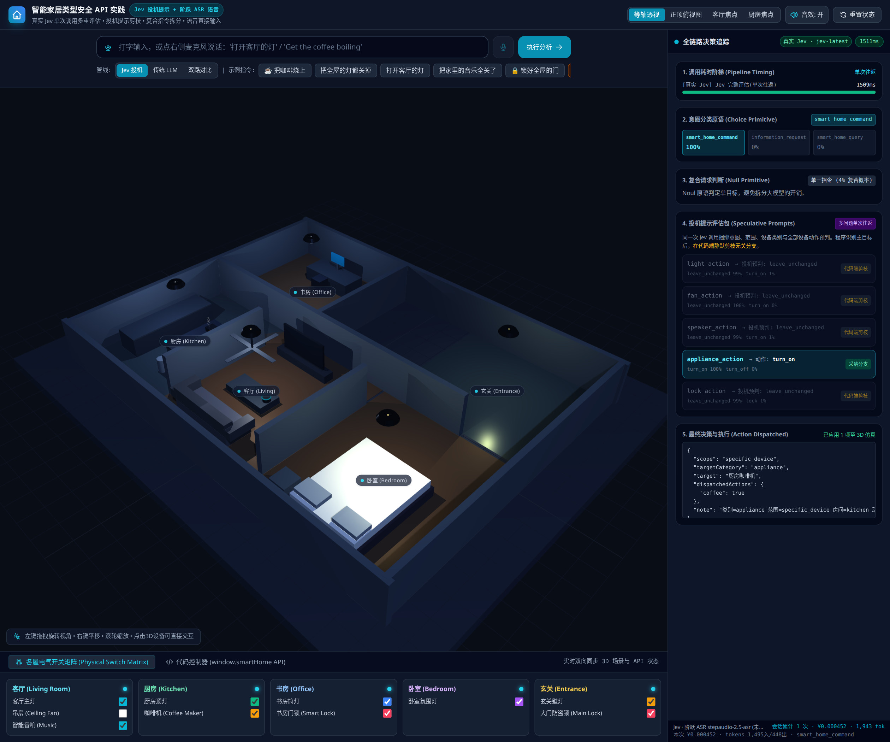

# Jev Cookbook 学习笔记与实战实验

基于开源教程 [Jev Cookbook](https://github.com/datawhalechina/jev-cookbook) 的个人学习仓库：
**第 1–5 章的中文学习笔记**，加上把 Jev 接进真实项目的**专题实验**。

笔记强调三件事：基于实际运行输出、命令可复现、踩坑有记录。
不是教程的逐字翻译，而是「自己跑过一遍之后」的整理与补充。

## 内容速览

| 部分 | 主题 | 入口 |
| --- | --- | --- |
| 第 1 章 | Jev 是什么：System One 的定位、与生成式 LLM 的区别、类型化判断流程、概率与校准 | [笔记](第1章_认识Jev_学习笔记.md) |
| 第 2 章 | 核心概念：System One、state、三种原语（Choice / Score / Noul）、置信度分流 | [笔记](第2章_核心概念_学习笔记.md) |
| 第 3 章 | 架构模式：代码掌控制权，四种模式（推测性扇出、置信度门控、复合评分、意图路由） | [笔记](第3章_架构模式_学习笔记.md) |
| 第 4 章 | 实战指南：18 篇配方（自一致性、重排序、语义搜索、引用核查、SDE 级联等）与横向小结 | [笔记](第4章_实战指南_学习笔记.md) |
| 第 5 章 | 智能家居实验：投机调用复刻、3D 演练场实测、服务端/前端分工与踩坑 | [笔记](第5章_智能家居实验_学习笔记.md) |
| 专题 | teach_agent 主题重排：用 Jev 判定「课堂主题 → 教材小节」，含可运行 demo | [实验报告](专题_teach_agent主题重排实验/README.md) |



## 各部分要点

### 第 1 章 · 认识 Jev

- Jev 不做文本生成，只做**类型化判断**：输入状态与问题，输出带概率的结构化答案。
- 与普通生成式 LLM 的分工差异：模型管语义，代码管规则，高风险动作留人工。
- 判断流程固定为：证据 state → 类型化问题 → 概率分布 → 代码策略 → 业务动作。
- 概率可信的前提是**校准**：群体频率对齐，不保证单次正确。

### 第 2 章 · 核心概念

- 一次判断拆成完整数据流：state → 问题 → 答案 → 置信度 → 业务动作。
- 三种原语对应三种答案空间：`Choice`（选项）、`Score`（序数量表）、`Noul`（是/否）。
- 重点区分四个容易混淆的概念：概率、置信度、正确性、校准。
- 置信度分布的形状决定分流策略：直接采纳、追问澄清、转人工。

### 第 3 章 · 架构模式

四个可复用的编排模式，核心都是「代码掌控制权，模型只做原子判断」：

1. 推测性扇出（Speculative fan-out）
2. 置信度门控路由（Confidence-gated routing）
3. 复合评分（Composite scoring）
4. 意图路由（Intent routing）

### 第 4 章 · 实战指南

18 篇配方的中文实验记录，覆盖自一致性 Noul/Choice、并行提问、重排序、逐行语义搜索、
结构恢复、函数调用、技能推荐、实体对齐、RAG 段落分类、引用核查、LLM 防护栏、
SDE 级联、日期抽取、预解析值抽取、层级分类、自动研究特征发现、基于置信度的分类。
最后一节横向总结这些配方复用的同一套手法。

### 第 5 章 · 智能家居实验

完整跑通语音智能家居 demo，记录三部分内容：

- 在 Notebook 里复刻一次投机调用；
- 3D 演练场实测（含决策追踪面板与复合指令编排截图）；
- 服务端与前端的分工逻辑，以及本地环境踩到的坑。

### 专题 · teach_agent 主题重排

把「课堂主题 → 教材小节」的纯向量排序升级为「向量召回 + Jev 重排」：

- Jev 只对前 6 个候选做 3 档 `Score` 判定，**不扩大召回范围**；
- 教材确实没有的主题会得到全 0，落到 `needs_review` 而不是硬凑；
- 人工已审核的映射不会被重排覆盖；
- 超时、报错或 schema 不符时自动回落向量排序。

含可运行 demo、真实响应样本与离线对比脚本，详见[实验报告](专题_teach_agent主题重排实验/README.md)。

## 推荐阅读顺序

1. **入门**：第 1 章 → 第 2 章，先建立「类型化判断」的心智模型；
2. **编排**：第 3 章，理解代码与模型的分工；
3. **查手册**：第 4 章按需查阅，不必顺序读完；
4. **完整项目**：第 5 章，看一次端到端落地；
5. **接入自己的系统**：专题实验，看如何把 Jev 当作判定器插进现有链路。

## 目录结构

```text
jev_cookbook_learning/
├── README.md
├── 第1章_认识Jev_学习笔记.md
├── 第2章_核心概念_学习笔记.md
├── 第3章_架构模式_学习笔记.md
├── 第4章_实战指南_学习笔记.md
├── 第5章_智能家居实验_学习笔记.md
├── 第5章_智能家居实验_图像/          # 演练场实测截图
└── 专题_teach_agent主题重排实验/
    ├── README.md                     # 实验报告（含 demo 与真实输出）
    └── code/
        ├── src/teach_agent/          # 客户端、重排逻辑、CLI 配置
        ├── tests/                    # 单元测试
        └── scripts/                  # demo、录制响应、离线对比
```

## 如何复现

### 阅读笔记

纯 Markdown，无构建步骤。建议在支持数学公式与相对图片的阅读器（GitHub、Typora、VS Code）中打开。

### 运行第 5 章智能家居实验

需要官方 cookbook 的 `main/` 目录与配套服务：

```bash
cd ~/self_study/jev_study/jev-cookbook/main
export TYPESAFE_API_KEY=你的密钥
export JEV_RUN_MODE=auto    # auto / live / offline
.venv/bin/jupyter lab "05_智能家居实验/01_智能家居实验.ipynb"
```

截图中的复合指令部分，未配置 `STEPFUN_API_KEY` 时使用本地模拟兜底数据，笔记中已明确标注。

### 运行专题 demo

```bash
# 代码是补丁式参考实现，需放回 teach_agent 副本目录
cd ~/agent_project/teach_agent_jev
cp .env.example .env        # 填入自己的密钥；.env 不入库
.venv/bin/python scripts/demo_jev_mapping.py
```

`code/` 下的文件不是独立可安装的包，目录结构与原项目保持一致，便于直接对照替换。

## 环境与密钥

| 项目 | 说明 |
| --- | --- |
| Python | 3.12（Notebook 与专题代码均在此版本验证） |
| Jev SDK | `typesafe-sdk`，导入名 `typesafe_sdk` |
| 密钥 | `TYPESAFE_API_KEY`（专题中亦可 `TEACH_JEV_API_KEY`），**只放环境变量或本地 `.env`** |
| 模型 | 默认 `jev-latest` / `jev-1.13.0`，可用环境变量覆盖 |

仓库内**不包含任何密钥**。若在 `.env.example` 中填入真实密钥，请注意该文件可能入库，
建议只保留占位符，把真实值放在被忽略的 `.env` 中。

## 说明

- 笔记内容基于实际运行输出整理；离线兜底、模拟数据等情形均在文中标注。
- 官方教程与翻译内容版权归原作者，遵循 CC BY-NC-SA 4.0；本仓库为个人学习记录。
- 欢迎交流指正。

## 相关链接

- 官方教程：[datawhalechina/jev-cookbook](https://github.com/datawhalechina/jev-cookbook)
- 在线阅读：[Jev Cookbook](https://datawhalechina.github.io/jev-cookbook/)
- TypeSafe AI：[typesafe.ai](https://typesafe.ai)
