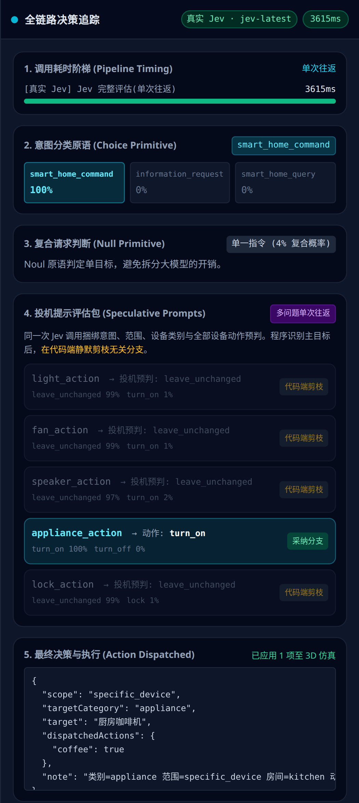
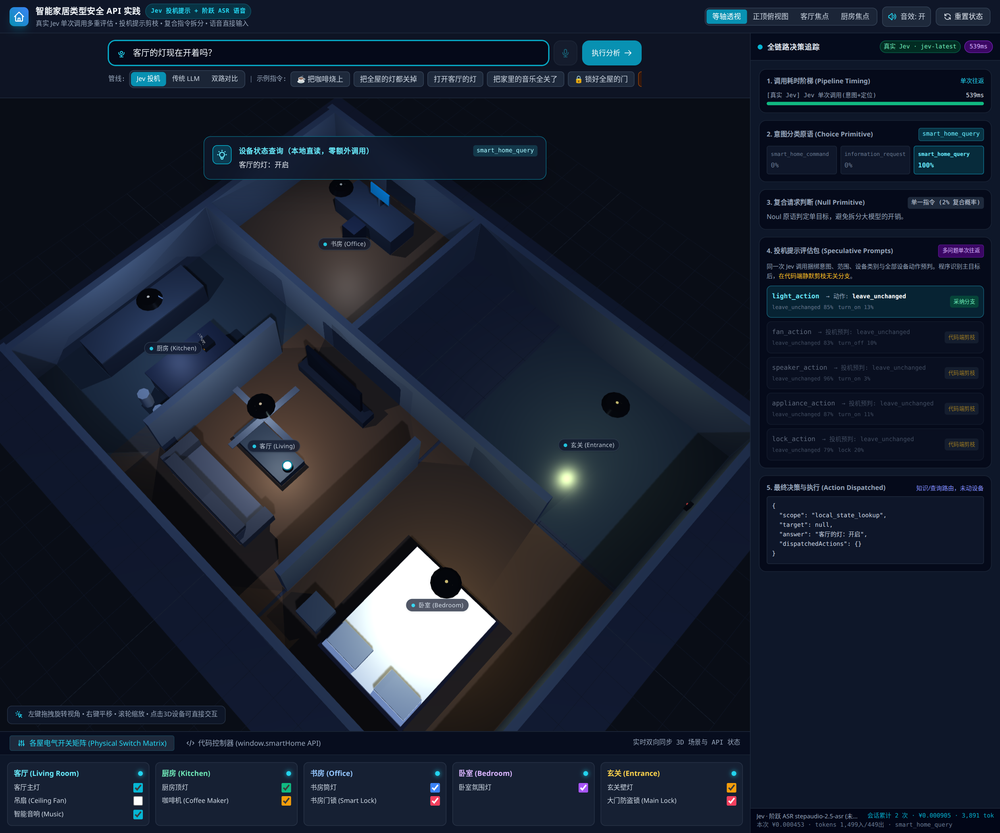
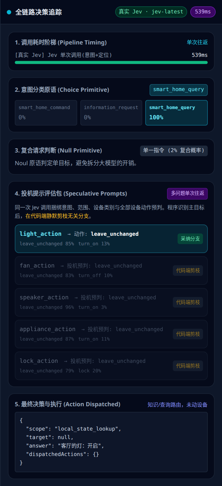
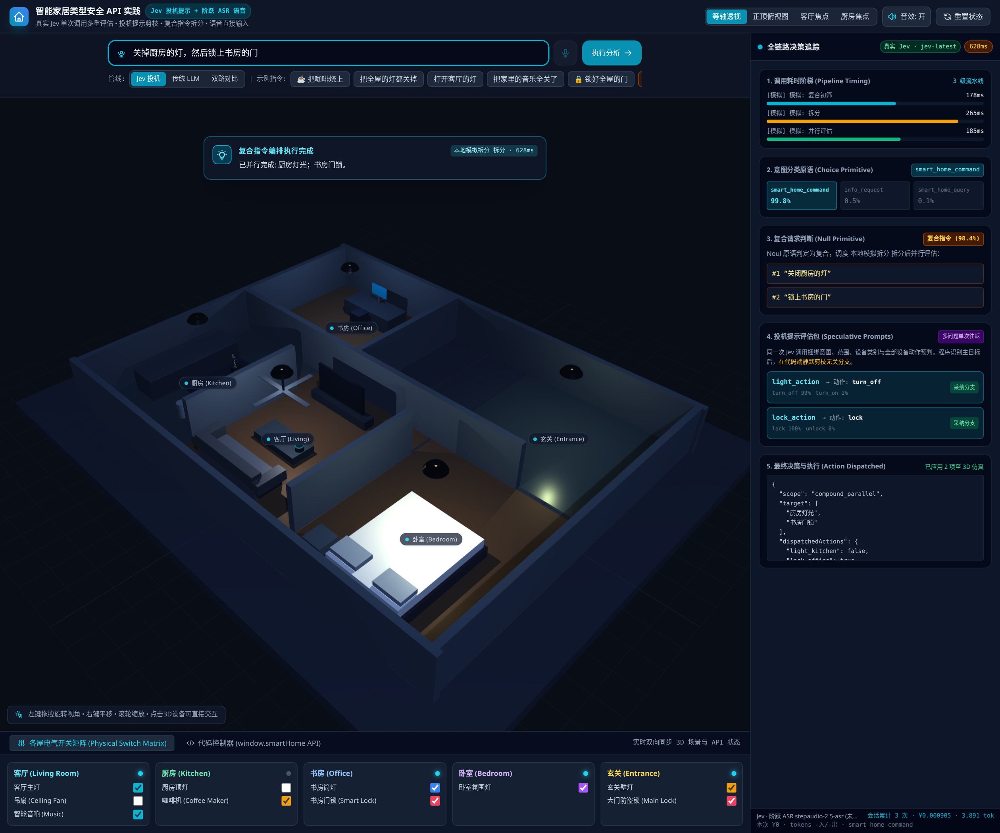
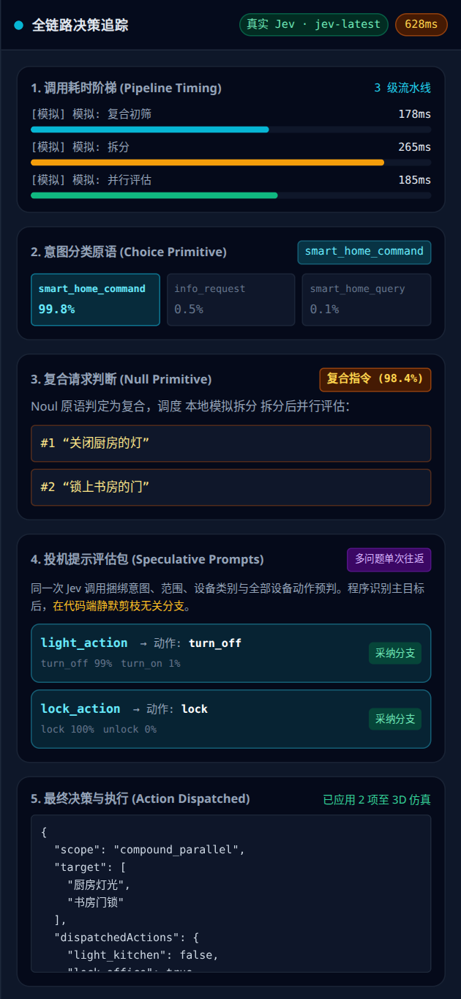

# 第 5 章 · 智能家居实验 学习笔记

- **学习时间**：2026/10/24
- **对应材料**：`jev-cookbook/main/05_智能家居实验/`（`01_智能家居实验.ipynb`、`README.md`、`smart_home_demo/`）
- **配套代码**：`serve_smart_home.py`（本地代理服务）、`smart_home_playground.html`（单文件 3D 应用）
- **运行环境**：Python 3.12 虚拟环境；服务端口 8843（避开默认 8810）；`TYPESAFE_API_KEY` 已配置
- **实测状态**：

| 能力 | 是否可用 | 说明 |
|---|---|---|
| Jev 真实调用 | 可用 | 健康检查 `jev: true`；上游返回模型自报 `jev-1.14.0`（别名 `jev-latest`） |
| 阶跃 ASR / Chat | 不可用 | 未配置 `STEPFUN_API_KEY`（`asr: false`、`chat: false`） |
| 3D 页面 | 可用 | 无 Key 时自动降级本地模拟引擎 |

因此本笔记里：**单指令与状态查询是真实 Jev 调用**；**复合指令、传统 LLM 对照、语音三条支路在本机不可用**，复合截图是 `LocalSimulator` 兜底画面，仅用于观察界面与编排逻辑，其百分比、耗时均非真实模型输出。

---

## 一、这个实验在验证什么

一句话：**让模型只做"受限的判断"，让代码承担所有副作用。**

| 层 | 负责 | 不负责 |
|---|---|---|
| Jev（类型化判断） | 意图分类、是否复合、作用范围、目标房间、设备类别、各设备动作预判 | 不生成文本、不执行设备操作 |
| 应用代码（确定性策略） | 白名单、动作映射、依赖排序、状态写入、失败与降级 | 不猜语义 |
| 3D 模拟器 | 展示状态变化 | 不是真实家居控制器 |

整个链路：

```text
用户语句
  → 构造 state + 候选问题包
  → Jev 单次返回类型化判断（choice / noul / score）
  → 应用代码读取需要的分支、剪掉无关分支
  → 按确定性策略派发动作
  → 3D 房间更新 + 追踪面板记录
```

这与前三章的概念完全对齐：**Choice 给选项概率、Noul 给"是/否"概率、Score 给有序评分**，三者都只产出"判断信号"，阈值和动作是本地策略。

---

## 二、启动配套服务

Notebook 第 1 个代码单元做三件事：探活 → 未启动则拉起 `serve_smart_home.py` → 打印健康检查。

```python
PORT = 8843
BASE = f"http://127.0.0.1:{PORT}"
# 探活失败才启动，避免重复拉起
if not up():
    subprocess.Popen([sys.executable, "serve_smart_home.py",
                      "--port", str(PORT), "--no-open"], cwd=..., env=env)
```

实测健康检查输出：

```json
{"jev": true, "asr": false, "chat": false,
 "asr_model": "stepaudio-2.5-asr", "chat_model": "step-1o-turbo-vision",
 "answer_model": "step-3.5-flash", "compare_model": "step-5-preview"}
```

**为什么必须有这一层本地服务？** 源码注释写得很直接，两条原因都值得记住：

1. `api.typesafe.ai` 与 `api.stepfun.com` 不保证给浏览器 CORS 头，页面直连会被拦；
2. API Key 不能出现在页面里，只能放在本地服务的环境变量中。

所以浏览器只和 `127.0.0.1:8843` 通信，由 Python 服务代持密钥并转发。端点分工：

| 端点 | 上游 | 用途 |
|---|---|---|
| `POST /api/jev` | `/v1/systemone` | 单次投机提示调用，原样返回 `body` + `upstream_ms` |
| `POST /api/asr` | `/v1/audio/asr/sse` | 流式语音识别，SSE 分块原样透传 |
| `POST /api/chat` | `/v1/chat/completions` | 复合指令拆分（`step-1o-turbo-vision`）、常识问答（`step-3.5-flash`）、对照（`step-5-preview`） |
| `GET /api/health` | 无 | 告诉页面哪些 Key 已配置，决定真实 Jev / 本地模拟 |

`/api/jev` 自己计时并返回 `upstream_ms`，这就是页面上"上游耗时"与"客户端耗时"能分开显示的原因。

---

## 三、Notebook 里复刻一次投机调用

### 3.1 问题包

Notebook 用最小版本演示：`intent`（三选一）、`is_compound`（noul）、`category`（六选一）、以及家电/灯/门锁三类动作预判。注意 **state 只放当前状态，不放"应该做什么"**——动作判断交给模型，执行交给代码。

```python
payload = {"state": state, "model": "jev-latest", "questions": {
    "intent": {...}, "is_compound": {"type": "noul", ...},
    "category": {...},
    "appliance_action": {...}, "light_action": {...}, "lock_action": {...}}}
```

### 3.2 实测结果（"把咖啡烧上"）

```text
上游耗时 777 ms
  intent            -> smart_home_command top=smart_home_command(1.00) ← 采纳
  is_compound       -> 0.09             top=noul(0.09)（投机，代码端剪枝）
  category          -> appliance        top=appliance(1.00) ← 采纳
  appliance_action  -> turn_on          top=turn_on(1.00) ← 采纳
  light_action      -> leave_unchanged  top=leave_unchanged(0.97)（投机，代码端剪枝）
  lock_action       -> leave_unchanged  top=leave_unchanged(0.97)（投机，代码端剪枝）
```

三个关键点：

1. **没有问"咖啡机应该怎样"之外的东西吗？** 问了——连灯和门锁也问了。这就是投机：本次用不到的分支（`light_action`、`lock_action`）在代码端直接丢弃，**不产生第二次网络往返**。
2. **"保持现状"也是一个有效答案**。0.97 的 `leave_unchanged` 说明模型认为这句指令与灯无关，而不是"灯的概率算不出来"。
3. **`is_compound` 的 0.09 是概率，不是布尔**。是否算"复合"由代码定阈值（页面版用 0.5），模型只提供 Noul 概率。

### 3.3 页面版的"问题包"更大

3D 应用里实际发的是 **10 个问题**，比 Notebook 多了 `scope`（全屋/单房间/具体设备）和 `target_room`（五个房间），以及全部五类动作预判（灯、风扇、音响、家电、门锁）：

```text
intent / is_compound / scope / target_room / category
+ light_action / fan_action / speaker_action / appliance_action / lock_action
```

问题越多，输入 token 越多，但**往返次数仍是 1**。这正是"用 token 换延迟"的取舍。

---

## 四、3D 演练场实测

### 4.1 页面总览

页面开机自动执行一次"把咖啡烧上"（源码 `BOOT` 段）。左侧是 3D 房间 + 指令栏，右侧是"全链路决策追踪"五节面板，底部抽屉是物理开关矩阵 / 前端 JS 控制台。


界面要素：

- 顶部视角切换：等轴透视、正顶俯视图、客厅焦点、厨房焦点；
- 指令栏：文字输入 + 麦克风 + 九条示例指令（含复合、常识路由、状态查询、英文指令）；
- 管线切换：`Jev 投机` / `传统 LLM` / `双路对比`；
- 右侧追踪面板：耗时阶梯 → 意图 → 复合判断 → 投机评估包 → 最终派发 JSON；
- 底部：每屋灯、吊扇、音响、咖啡机、门锁的物理开关，以及 `smartHome.setAllLights(false)` 这类 API 的代码控制台。

### 4.2 单指令："把咖啡烧上"（真实 Jev）



面板逐节读法：

| 面板节 | 本次结果 | 说明 |
|---|---|---|
| 1. 调用耗时阶梯 | 单次往返 1509 ms | 只有一段 `Jev 完整评估(单次往返)`，说明没有二次调用 |
| 2. 意图分类 | `smart_home_command` 100%，其余 0% | Choice 的概率分布直接展示，不只看选中项 |
| 3. 复合请求判断 | 单一指令（4% 复合概率） | Noul 给的是概率；4% 远低于阈值，不触发拆分 |
| 4. 投机提示评估包 | 5 类动作全部有答案 | `appliance_action` 命中 `turn_on` 100%，标记"采纳"；其余标"代码端剪枝" |
| 5. 最终派发 | `{"coffee": true}`，目标"厨房咖啡机" | 代码把 `category=appliance` + `scope=specific_device` 映射成具体设备键 |

注意第 4 节里 `light_action` / `fan_action` / `speaker_action` / `lock_action` 都返回了"保持现状 99% 左右"——**这些分支不是没问，而是问了不用**。它们的存在让"下一条真的锁门指令"可以直接复用同一套调用结构，代价是每次多花一点输入 token。

同时注意第 5 节的 `scope`、`target`、`note` 都是由 `resolveDispatch()` 拼出来的**确定性结果**，不是模型生成的自然语言。

### 4.3 状态查询："客厅的灯现在开着吗？"（真实 Jev）





- 耗时 **397 ms**，比控制指令更短——因为只做了一次 Jev 判断；
- 意图是 `smart_home_query` 100%，`light_action` 为 `leave_unchanged` 95%（查询不是动作，不应派发）；
- 第 5 节 `scope: "local_state_lookup"`、`target: null`、`dispatchedActions: {}`；
- 回答"客厅的灯：开启"来自 3D 状态**本地读取**，没有再调大模型。

这条路径体现了本章最重要的分工：**语义解析（问 Jev）和状态读取（读本地）必须分开**。模型不负责告诉你灯现在开没开，它只负责告诉你用户在问哪盏灯。

### 4.4 复合指令："关掉厨房的灯，然后锁上书房的门"





**先说明这张图的性质**：本机没有 `STEPFUN_API_KEY`，复合链路在"LLM 拆分"这一步失败，整条 `JevPipeline` 抛错后被 `runEngine` 捕获并降级到 `LocalSimulator`。因此图中的 98.4% 复合概率、628 ms 耗时、三段耗时（178/265/185 ms）都是模拟器写死的演示值，**不能当作真实模型结论**。

界面本身仍然把真实链路的形状展示出来了：

```text
① Jev 复合初筛（is_compound，一次调用）
   ↓ noul ≥ 0.5
② LLM 拆原子子指令（温度 0，最多 4 条）
   ↓
③ Jev 依赖编排（单次调用同时问两类问题）
     prio_i  : score  → "这条应该多早执行"
     before_i_j : noul → "A 必须在 B 之前吗"
   ↓ 依赖阈值 0.6
④ 每条子指令再各走一次 Jev，按拓扑序串行入栈，或两两无依赖时并行
```

源码里的编排细节：

- `sequencingQuestions(subs)`：为每条子指令生成一个 `score` 问题，为每一对子指令生成一个 `noul` 问题，**仍然塞进同一次调用**；
- `buildExecutionPlan()`：`noul >= 0.6` 记为真依赖，有依赖就 `serial`，无依赖就 `parallel`；拓扑排序时用 `score` 做同层优先级，循环依赖兜底取剩余第一条；
- 串行执行是"逐个推栈"：每完成一条就写 `state.devices` 并 `syncDeviceStateTo3D()`，再执行下一条，避免并行写同一设备造成竞态；
- 并行执行才用 `Promise.all`，且合并动作时后写覆盖先写——这也是"同一设备连续动作必须串行"的原因。

这也解释了 README 反复强调的点：**"然后"意味着顺序约束；依赖关系是模型的信号，但"用 0.6 还是 0.5 当阈值"是本地策略。**

### 4.5 传统 LLM 对照（本机未运行）

页面提供 `传统 LLM` 与 `双路对比` 两个按钮，走 `LlmPipeline`：**一次大模型调用包办意图、拆分、定位、动作**。系统提示词要求严格输出一个 JSON：

```json
{"intent": "...", "intent_confidence": 0.0, "answer": "...",
 "commands": [{"utterance": "...", "scope": "...", "room": "...",
               "category": "...", "action": "...", "confidence": 0.0,
               "depends_on": [0]}]}
```

值得学习的工程处理：

1. **结构化遵从失败有专门分支**：`parseLlmJson` 剥掉 markdown 代码块、截取首尾大括号，仍失败则返回 `llm_parse_error` 轨迹，不抛异常；
2. **LLM 的 `depends_on` 直接转成依赖图**，再用与 Jev 版相同的拓扑排序和 `resolveDispatch`，**保证两路派发语义一致**，对比才有意义；
3. **对比不是只比延迟**：`vsBlock` 同时列出耗时、token、费用、派发动作是否一致。

本机因缺 `STEPFUN_API_KEY` 无法实测，`双路对比` 只会显示 LLM 侧错误信息——这也是"没有 Key 时页面仍能跑，但对照结论不可得"的边界。

### 4.6 语音输入（本机未运行）

- 浏览器采 16 kHz 单声道 PCM，优先用 `AudioWorklet`，不支持时回退 `ScriptProcessor`（接零增益节点防回声）；
- 分块 base64 发 `POST /api/asr`，服务端把阶跃 SSE **原样 chunked 透传**，前端边收边把增量文字填进输入框；
- 15 秒自动停止，ESC 取消；录音 HUD 显示计时与电平条；
- Notebook 特别提醒：**iframe 内录音常被浏览器限制，语音建议在独立标签页体验**。

时间线上要区分四个阶段：ASR 首字延迟 → 识别完成 → Jev 判断 → 动作执行。把它们混成一个"总延迟"会掩盖真正的瓶颈。

---

## 五、代码实现拆解

### 5.1 前端关键函数

| 函数 / 类 | 职责 | 值得注意 |
|---|---|---|
| `jevQuestions()` | 构造 10 个问题的投机包 | 问题内容与教程一致，含全部动作预判 |
| `jevSystemOne()` | `POST /api/jev`，返回 `body`、`clientMs`、`upstreamMs` | 客户端与上游耗时分开计时 |
| `resolveDispatch()` | 把 answers 映射成设备动作 | 纯确定性分支，**剪枝就发生在这里** |
| `singleJevTrace()` | 整理成追踪面板需要的结构 | 标记 `pertinent`（命中主目标）的分支 |
| `JevPipeline.evaluate()` | 路由 A/B/C/D | 信息请求、状态查询、复合、单指令四条出口 |
| `LlmPipeline.evaluate()` | 一次 LLM 直答 + JSON 解析 | 与 Jev 共用 `resolveDispatch` |
| `LocalSimulator` | 无 Key / 调用失败时兜底 | 关键词匹配，数值写死，仅用于演示 |

`resolveDispatch()` 的剪枝逻辑很值得抄下来：

```js
const actionQ = { lighting: 'light_action', appliance: 'appliance_action',
                  lock: 'lock_action', fan: 'fan_action',
                  speaker: 'speaker_action' }[category];
if (!actionQ) { /* category 未落到具体设备 → 全部剪枝，不派发 */ }
else {
  const action = answers[actionQ].choice;
  if (!action || action === 'leave_unchanged') { /* 保持现状 → 不派发 */ }
  else { /* 根据 scope / target_room 填具体设备键 */ }
}
```

**先看类别，再看动作，最后看范围**——顺序固定、没有模型参与，所以同一份答案永远得到同一个派发结果。

### 5.2 服务端要点

- `ThreadingHTTPServer` + `protocol_version = "HTTP/1.1"`，每个响应都带 `Content-Length`，避免 keep-alive 卡死；
- `/api/jev` 捕获 `HTTPError` 与连接异常，统一回 `{ok, status, upstream_ms, body}`，页面据此决定是否降级；
- `/api/asr` 用 `http.client` 手动转发并写入 chunked 编码，**不做解析、不做缓冲**；
- `/api/chat` 按 `purpose` 选模型：拆分用快的、问答用准的、对照用强的；
- `--tls` 用 openssl 自签证书，方便局域网手机测麦克风（`getUserMedia` 在非 localhost 的 HTTP 页面会被禁用）。

### 5.3 成本统计

页面用一张 `PRICING` 表把 token / 时长换算成人民币：Jev 输入 `$0.042/M`、输出免费；阶跃三个模型分别输入/输出计价；ASR 按小时计费（`stepaudio-2.5-asr` 0.15 元/小时）。会话累计在 footer 显示次数、费用、token。

注意这只是**按公开单价做的估算**，汇率写死 7.2，且不同计费口径（如推理 token 是否计入输出）会带来偏差；比较两路成本时不要把单次结果当普遍倍数。

---

## 六、实测踩到的坑

1. **"引擎徽标"不等于"本次真的用了 Jev"**
   顶部 `engineBadge` 只看 `/api/health` 里有没有 Key。复合截图里它显示"真实 Jev · jev-latest"，但耗时条每段前缀都是 `[模拟]`。判断一次调用到底走了哪条路，**要看轨迹里的 `engine` 字段和每段耗时条的标签**。

2. **模拟兜底的提示文案会误导**
   上游偶发失败时，`catch` 分支里模拟轨迹的 `note` 固定写着"本地模拟引擎（未配置 TYPESAFE_API_KEY）"。第一次截图时 Key 明明是配好的，只是当次请求失败，页面却显示"未配置 Key"。读日志要结合 `console.warn('Jev pipeline failed, degrade to sim:', e)`，不要只信横幅。

3. **上游不稳定会整条链路降级**
   抓图过程中遇到过 1509 ms 成功、也遇到过超时后直接变模拟。实验记录必须写清"本次是真实调用还是降级"，否则数据无法复现。

4. **复合链路比想象中长**
   一次复合指令最多 1（初筛）+ 1（编排）+ N（子指令）次 Jev 调用，外加 1 次 LLM 拆分。子指令越多，串行栈越慢；能并行的前提是"两两无依赖"，而不是"看起来无关"。

5. **页面开机自动执行指令**
   `BOOT` 段会先 `await ENGINE.init()` 再执行"把咖啡烧上"，所以打开页面就有一次调用和一份轨迹；`重置状态` 按钮也会顺带执行"打开客厅的灯"。截图前要意识到这一点，别把开机轨迹当成自己发的指令。

6. **正顶俯视图并不是严格垂直**
   点击"正顶俯视图"后相机被移到 `(0, 26, 0.1)`，画面仍保留明显倾斜。相机正上方时视线与 `up` 向量接近平行，OrbitControls 的球坐标与 `lookAt` 处理会产生这种效果。想拍真正的平面图，需要额外调整 `camera.up` 或直接换正交相机。

---

## 七、与前三章概念的对应

| 本章环节 | 对应原语 | 关键区别 |
|---|---|---|
| 意图三选一 | Choice | 看完整概率分布，不只看 top-1 |
| "是否复合" | Noul | 概率 + 本地阈值 0.5 |
| "A 是否必须先于 B" | Noul | 概率 + 本地阈值 0.6 |
| "这条子指令多早执行" | Score | 只用于同层排序，不单独决定顺序 |
| 五类动作预判 | Choice ×5 | 一次请求全问，代码剪枝 |
| 状态查询 | Choice 定位 + 本地读取 | 模型不碰状态值 |
| 常识问答 | Choice 意图 + LLM | 快而确定的走 Jev，开放式的走 LLM |

可以把它记成一句话：**Jev 输出的是"带概率的标签"，应用输出的是"确定的副作用"。**

---

## 八、小结

- 这个实验真正演示的不是 3D 房子，而是**一条"语义判断与执行分离"的完整链路**：一次投机调用 → 代码剪枝 → 确定性派发 → 状态可视化。
- 投机提示的收益是**省往返**，成本是**多问几个问题**；收益是否划算取决于"无关分支被真正用到的比例"，这个比例只能用代表性指令集去测。
- 复合指令的难点不在拆分，而在**依赖判断与执行语义**：阈值、拓扑序、串/并行、失败恢复、幂等，全部是本地代码的责任。
- 无 Key 时的本地模拟让页面"永远能演示"，但也制造了两个陷阱：**徽标骗人、文案骗人**。做实验记录时要明确标注数据来源。
- 本机受限于缺少 `STEPFUN_API_KEY`，只完整验证了单指令与状态查询两条真实路径；复合、LLM 对照、语音留待配置后按同一脚本复跑。

### 复现清单

```bash
# 1. 启动服务（在 05_智能家居实验 目录）
python3 smart_home_demo/serve_smart_home.py --port 8843 --no-open

# 2. 需要真实 Jev
export TYPESAFE_API_KEY=...

# 3. 需要复合拆分 / 对照 / 语音
export STEPFUN_API_KEY=...

# 4. 打开页面，切换管线与示例指令，观察右侧五节追踪
http://127.0.0.1:8843/
```

复跑前先看 `/api/health` 的 `jev / asr / chat` 三个布尔值，再决定这条实验结果能不能写进报告。
